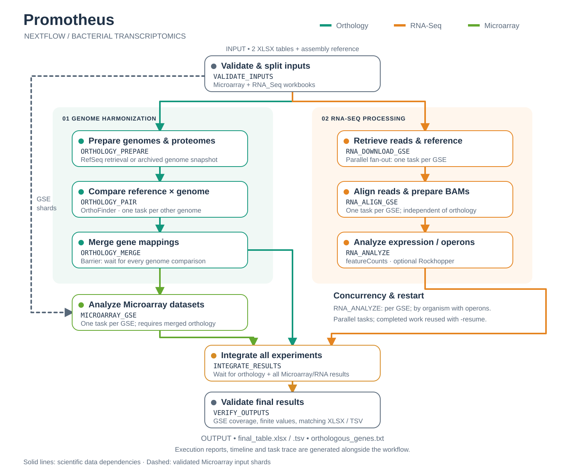

# Promotheus

Promotheus retrieves and integrates bacterial Microarray and RNA-Seq data from NCBI to identify promoters with stable or variable expression. It harmonizes gene identifiers through orthology and produces expression, percentile, variability and promoter-sequence tables.

## Pipeline overview



Colored routes follow the Microarray and RNA-Seq overview on `main`; boxes show the actual Nextflow processes. Genome comparisons run in parallel, as do GSE download/alignment tasks. Optional Rockhopper analysis runs inside `RNA_ANALYZE`, grouped by organism when enabled. [Full-size DAG](docs/images/promotheus-nextflow-dag.svg) · [Workflow details](docs/MODULAR_NEXTFLOW.md).

## Run with Nextflow

Requirements: **Nextflow ≥23.10, Java ≥17, Python 3 and Docker running**. The workflow launches Docker automatically and mounts the updated repository scripts into a pinned `linux/amd64` image; ARM machines use emulation.

```bash
git clone --branch nextflow https://github.com/Ste40/Promotheus.git
cd Promotheus

nextflow run main.nf \
  -profile standard,balanced \
  --input_dir /absolute/path/to/input \
  --output_dir /absolute/path/to/output \
  --asmcode ASM317683v1 \
  --threads 8 --memory 20000 \
  --task_cpus 2 --task_memory 8000 \
  --orthology_cpus 1 --orthology_memory 3000 \
  --max_orthology_parallel 6 \
  --operons_detection false
```

Allocate the requested resources to Docker. This example uses a 20,000 MB total budget; `balanced` reserves room for one RNA-Seq task and limits orthology to four concurrent comparisons. Use `-profile standard` to omit this reservation. Reserving resources can reduce RNA-Seq waiting time but does not guarantee a shorter total run.

To resume, repeat the command with **`-resume`** and retain the `work/` and `.nextflow/` directories.

## Inputs and parameters

Place exactly two Excel workbooks in the input directory: one filename containing `Microarray`, the other containing `RNA_Seq`. Use the format in [Examples](Examples) or generate tables with `Rscript GEO_Search.R --taxID <taxID>`. Do not include `Output.xlsx` or unrelated workbooks. Input preparation and required R packages are described in the [input guide](docs/LEGACY_USAGE.md#input-files).

| Parameter | Purpose |
| --- | --- |
| `--asmcode` | Required orthology reference, in `ASM<digits>v<digits>` format; alignment references come from the input tables. |
| `--threads`, `--memory` | Total local CPU and memory budget (MB). |
| `--task_cpus`, `--task_memory` | Resources per Microarray/RNA-Seq/scientific task. |
| `--max_gse_parallel` | Maximum concurrent tasks per GSE stage (default: 2). |
| `--max_orthology_parallel` | Maximum concurrent genome comparisons (default: 4). |
| `--orthology_cpus`, `--orthology_memory` | Resources per genome comparison (defaults: 1 CPU, 3000 MB). |
| `--operons_detection` | Operon analysis (default: `true`; disabled in the validated example above). |

See [nextflow.config](nextflow.config) for all defaults and the [workflow guide](docs/MODULAR_NEXTFLOW.md) for the DAG, dependencies, resource allocation and restart behavior. Orthology parallelizes by genome; RNA-Seq download/alignment and Microarray analysis parallelize by GSE. With operons enabled, downstream RNA-Seq analysis is grouped by organism.

## Results

- `results/final_table.xlsx` and `.tsv`: integrated expression, percentiles, variability, differential-expression status and promoter sequences.
- `orthologous_genes.txt`: cross-genome gene mapping.
- `pipeline_info/`: execution report, timeline, task trace and DAG.
- `.promotheus-nextflow/output_validation.json`: must report **`"status": "pass"`**.

Real runs may take hours and require substantial disk space. Some GEO datasets have unavailable or unsupported supplementary files; incomplete GSE coverage fails validation.

## Validation and performance

RNA-Seq checks now match count columns to run IDs and reject mixed single-/paired-end GSEs and multiple runs per GSM instead of processing them ambiguously. Output validation rejects non-finite values, empty/duplicate gene IDs, and Excel/TSV content mismatches. These corrections have regression tests; the full-run timings below describe the earlier benchmarked revision.

The full Docker-backed Nextflow run on **3 November 2026** completed **136 tasks without cache in 3 h 42 min**, including 127 genome comparisons, GSE8182 and GSE116952. All ten samples were present in the final **352 × 28** table; comparison with the preceding validated run found no differences within the numeric tolerance. Operons were disabled and genomes came from an archived snapshot.

The balanced profile reduced the observed download-to-alignment wait from 2 h 13 min to 1.1 s. The preceding run was partially cached, so these runs do **not** establish an overall speedup. See [performance evidence](docs/PERFORMANCE.md), the [per-task report](docs/TASK_PERFORMANCE.md), and [orthology reproducibility](docs/ORTHOLOGY_REPRODUCIBILITY.md). Formal biological equivalence with the original monolithic workflow remains untested.

A fresh two-comparison orthology benchmark on **4 November** took **8 min 46 s serially versus 4 min 58 s in parallel** (1.77×), with byte-identical results. This measures the orthology branch only; see the [method and results](docs/PERFORMANCE.md#controlled-comparison-4-november-2026).

A real standalone Rockhopper test on **10 November 2026** passed on GSE116952 (four paired-end samples, two replicate groups) in **13 min 9 s**, producing **490 predicted multi-gene operons**. The replicate-group mapping was corrected and the regression suite passed. This is a single-GSE component test, not a full Nextflow benchmark or biological validation; see the [operon test report](docs/OPERON_VALIDATION.md).

## Test with the bundled toy dataset

After cloning the `nextflow` branch, run this from its repository root. The toy test requires **Nextflow, Java and Python 3**, but **no Docker or NCBI data downloads**:

```bash
nextflow run main.nf -profile test \
  --input_dir tests/fixtures/toy_input \
  --output_dir toy-results \
  --asmcode ASM100001v1
```

The fixtures contain one synthetic Microarray GSE and one synthetic RNA-Seq GSE. The test runs the workflow with a mock analysis backend and produces a four-gene table. Confirm that the command exits successfully and `toy-results/.promotheus-nextflow/output_validation.json` reports `"status": "pass"`; the final workbook is `toy-results/results/final_table.xlsx`.

This checks workflow orchestration and output validation, **not the biological algorithms in Docker**. To check reuse of completed tasks, repeat the same command with `-resume` while retaining `work/` and `.nextflow/`.

For the full local regression suite, including parallel scheduling, failure recovery and cache invalidation:

```bash
bash tests/shell/test_all.sh
```

The suite additionally requires **R with the `openxlsx` package** and finishes with `PASS: all Promotheus Nextflow tests` on success.

See [validation details](docs/NEXTFLOW_EQUIVALENCE.md) for Docker checks and limitations.

## Legacy execution and license

The original orchestration remains available through `main_legacy.nf`; direct Docker instructions and output-column descriptions are in the [legacy guide](docs/LEGACY_USAGE.md).

Contributors: Stefano Quaranta, Debora Dallera and Lorenzo Pasotti. Distributed under GNU GPL v3; bundled components retain their licenses—see [third-party notices](THIRD_PARTY_NOTICES.md).
