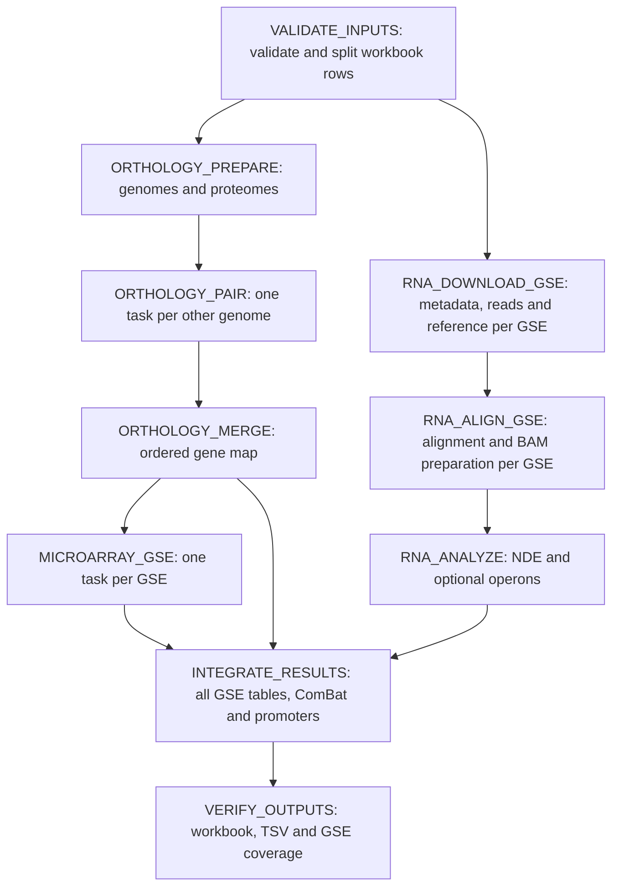

# Modular Nextflow execution

`main.nf` now schedules scientific stages directly. The former three-process
wrapper is preserved as `main_legacy.nf`. Both use the existing R scientific
functions and pinned image; the new workflow adds task-local adapters in
`bin/run_stage.R` and `bin/run_modular_stage.py`.



## Parallelism and dependencies

- Orthology runs one comparison of the preferred assembly against each other
  genome. Preparation downloads/parses the references once; independent
  `ORTHOLOGY_PAIR` tasks run OrthoFinder and the existing `find_ortologhi`
  function; merge restores the original genome order. This parallelism is
  per genome, independent of the number of GSEs. A failed pair prevents merge.
- Orthology and RNA-Seq download tasks can overlap. Microarray GSE tasks start
  after orthology and can overlap the RNA-Seq branch.
- Each RNA-Seq GSE has separate download and alignment tasks, including GSEs of
  the same organism. Genome files and indexes are private to these tasks. This
  first implementation deliberately duplicates reference preparation instead
  of letting several processes write the same genome/index directory.
- With `--operons_detection false`, `RNA_ANALYZE` is one task per GSE.
- With `--operons_detection true`, `RNA_ANALYZE` groups aligned GSEs by organism
  and processes them in original workbook order. This retains the existing
  threshold-dependent operon consensus and update order. Downloads and
  alignments still parallelize. Full per-GSE Rockhopper/NDE parallelism with
  operons enabled requires a separate equivalence-tested consensus refactor.
- An organism cannot use conflicting reference assemblies, or collide with
  another taxon after directory-name normalization. Such inputs fail early.
- Integration waits for all expected GSEs. A failed download, alignment or
  missing full table fails its task; partial integration is not silently accepted.

Tasks exchange declared Nextflow output paths. `publishDir` is only for final
publication, never for passing data to another process. The Python adapter
copies dependencies into a private writable output tree and mounts repository
scripts and inputs read-only. Shared reference files are checksum-compared
before merging an organism group. Original input workbook ordering is retained
when results arrive out of order.
After RNA analysis, empty organism directories are retained and passed to
integration because the existing operon filter discovers organisms from these
names. Raw reads and BAM files remain only in upstream task caches.

## Resources

```bash
nextflow run main.nf \
  --input_dir /path/to/input --output_dir /path/to/output \
  --asmcode ASM317683v1 \
  --threads 8 --memory 16000 --max_gse_parallel 4 \
  --task_cpus 2 --task_memory 4000 \
  --max_orthology_parallel 4 --orthology_cpus 1 --orthology_memory 3000 \
  --operons_detection false
```

`threads` and `memory` are the total local-executor CPU and memory budget.
`max_gse_parallel` caps each per-GSE process. The executor queue is the larger
of `max_gse_parallel` and `max_orthology_parallel`; total CPU/memory limits
still apply across all stages. Available resources can reduce actual
concurrency. `task_cpus` and `task_memory` (MB)
set resources per scientific task. Defaults divide the totals by
`max_gse_parallel`, with a minimum of one CPU and 512 MB per task. Docker also
enforces the task CPU and memory limits; inner GSE worker pools are disabled.
Heavy R tasks may need more memory than the 512 MB scheduling minimum.

Orthology pairs have separate settings: `max_orthology_parallel` (default 4),
`orthology_cpus` (default 1), and `orthology_memory` (default 3000 MB per pair).
The default total memory of 4000 MB only fits one pair; increase `memory` to
enable concurrency. The example above allows up to four pairs when resources
are available. Set `max_orthology_parallel` to 1 for serial comparisons.
Preparation and merge use the ordinary scientific-task resource settings.

To run only orthology, add `-entry ORTHOLOGY_ONLY` to the command above. Its
table is published at `output_dir/orthology/orthologous_genes.txt`. An optional
`--orthology_genomes /path/to/snapshot` skips genome downloads and uses exactly
the `.gb` files in that snapshot. It must contain `assembly_summary.txt` and
`tmp/orthologous_genome/*.gb`, including `<asmcode>.gb`. Supply the complete
intended genome set: the snapshot is not checked for species coverage and no
missing genomes are downloaded. Keep snapshots immutable; use a new directory
and a fresh run when changing their contents. Omitting this option retains the
existing species-wide reference download behavior.

## Restart and compatibility

Append `-resume` to reuse completed tasks. Keep the launch directory's
`.nextflow` cache and `work` directory. Download and alignment remain reusable
when changing only the operon switch. An interrupted run can resume individual
GSE stages or genome comparisons, rather than restarting the whole container.

All processes now include explicit SHA-256 source-content fingerprints in
their task cache keys. Validation and verification fingerprint `bin/`;
scientific processes fingerprint both `bin/` and `Scripts/`, recursively,
including nested imports and the Rockhopper JAR. Generated Python caches and
hidden files are excluded. Changes are detected even when file size and
timestamps are preserved. Unchanged runs remain reusable with `-resume`.

This policy is deliberately conservative: a scientific-source edit invalidates
all scientific stages, even if it affects only one branch. An adapter edit also
invalidates validation and verification. This avoids incomplete hand-maintained
dependency lists, at the cost of extra recomputation after code edits. The
first run after upgrading from the old fingerprint scheme also recomputes
tasks. Keep input/genome snapshots immutable; source fingerprints do not replace
the separate rules for input-directory caching. The historical October trial
below predates this policy and reused upstream work after an integration fix.

The legacy `--cache_dir` mechanism applies only to `main_legacy.nf`; the modular
workflow rejects that option and uses Nextflow caching. `--keep_cache` does not
delete modular task intermediates. The task cache can contain several copies
of reads/BAMs, so allow disk space for staged dependencies. Reference-download
and index deduplication is a future optimization.

Automatically inferred experimental groups are used. To preserve the previous
workflow for manually curated group workbooks in a resumed output directory,
run `main_legacy.nf`. The modular implementation does not yet expose curated
group files as an input channel.

## Validation

```bash
python3 tests/test_modular_workflow.py
python3 tests/test_parallel_orthology.py
python3 tests/test_source_cache.py
bash tests/shell/test_nextflow.sh
bash tests/shell/test_modular_container.sh  # optional: Docker, pinned image; no network
```

The modular integration test runs real Nextflow with two synthetic Microarray
GSEs and three RNA-Seq GSEs from the same organism. It checks simultaneous task
execution, injected alignment failure, blocked integration, reuse on resume,
all-cached second resume, GSE coverage, and the organism barrier for operons.
The two-GSE fixture remains byte-identical to the previous expected workbook.
The separate orthology test checks overlapping genome tasks, failed-pair
recovery, cache invalidation after source edits, publication, and a reference-only
snapshot with zero comparison tasks. R tests check ordered merge, rejection of
missing/duplicate/misaligned results, and equality with sequential accumulation
for fixed orthogroups, including tied matches and an empty result.

The mock engine generates synthetic stage outputs; these tests establish
orchestration and file contracts, not biological correctness or a speedup on
real data. Compare a real modular run with `main_legacy.nf`, using the same
input/data snapshot, before claiming scientific equivalence. In particular,
retain numerical tolerances, gene sets, DE flags and promoter sequences in
that comparison.

The optional container smoke test loads the actual scientific packages and
adapters and reads a split workbook with the image's `openxlsx`. It runs with
network access disabled and does not execute a complete biological analysis.
It explicitly checks column names and scalar accession values: comparisons
against missing R columns can otherwise produce `logical(0)` and incorrectly
pass `stopifnot`. The workbook writer uses plain XML text elements because the
pinned image's legacy reader mishandles attributes on inline-string text.

The real-data trial also exposed an integration bug shared with the legacy
workflow: RNA-Seq tables append `locus_tag` after the sample columns, so the
previous fixed column offset omitted the first RNA-Seq sample. Integration now
selects every sample before `means`, excluding named identifier columns, and
maps RNA loci to the preferred assembly even when no unmapped rows are dropped.
`tests/test_integration_samples.R` checks actual producer column layouts,
sample counts and values, reordered genes, and cross-assembly mapping. This
correction can change results compared with an uncorrected legacy run; such a
comparison must distinguish this bug fix from scheduling equivalence.

## Real execution on 27–28 October 2026

The modular Docker run completed for Microarray **GSE8182** (six samples) and
RNA-Seq **GSE116952** (four samples), using **ASM317683v1**, four total CPUs,
16,000 MB total memory, two CPUs / 8,000 MB per task, and operons disabled.
The output verifier passed with **352 genes, 28 columns, no missing GSEs,
no errors and no warnings**. A separate audit verified all ten expression
columns, all ten percentile columns and unique reference gene identifiers.

The first integration attempt exposed the GFF reader's named `attributes`
column where the code expected `V9`. Gene lookup now accepts both column
layouts and matches exact `locus_tag` attributes, avoiding prefix and old-tag
matches. The regression test also ran against the actual failing reference
gene in the pinned container.

After this correction, `-resume` reused six completed tasks and ran only
integration and output verification. Orthology took 6 h 12 min for 127
comparisons across 128 downloaded genomes; RNA download (28 min) and alignment
(25 min) overlapped it. Orthology was still a single task in this historical
run and dominated its duration; the per-genome implementation below came later.

Local evidence is in `../real-runs/2026-10-27/`: `run.sh`, `audit.py`,
`real_validation.json`, `output/results/final_table.xlsx`, its TSV export,
and timestamped Nextflow traces and DAGs under `output/pipeline_info/`.
This validates execution on these two real GSEs; it does not establish
biological equivalence with the legacy workflow or real-data operon analysis.

## Parallel orthology benchmark on 28 October 2026

A real Docker benchmark compared `max_orthology_parallel=1` and `2`, using the
same preferred assembly **ASM317683v1**, two other genomes (**A12**, **AF116-22**),
the pinned image, and **one CPU / 3000 MB per pair**. Both runs had four total
CPUs and 12,000 MB. Genomes came from a local snapshot, so no download time is
included. The time from validation start through merge completion was:

| Mode | Observed simultaneous pairs | Elapsed time |
| --- | ---: | ---: |
| Serial | 1 | 8 min 32 s |
| Parallel | 2 | 4 min 59 s |

This is **1.71× faster / 41.6% less wall time** in one trial per mode, including
preparation and merge. It is not a measurement across all 127 comparisons, nor
a guarantee of linear scaling. Each pair retains its `N0.tsv` and mapping in
its own Nextflow cache; successful pairs can be reused after another fails.

Both tables contain 2565 rows and nine columns. The four reference columns
match exactly, but 14 mapping cells across 12 rows differ. Two additional
sequential runs of standalone OrthoFinder on identical A12/reference proteomes
also differ: their normalized gene-group sets have a symmetric difference of
12 groups. Two sequential repeats with `PYTHONHASHSEED=0` still differ by four
groups. Thus variability occurs before R matching and without parallel
execution. A subsequent investigation isolated unstable distance-matrix and
candidate-gene ordering and corrected both in the modular adapter; see
[Orthology repeatability correction](ORTHOLOGY_REPRODUCIBILITY.md). No seed or scientific
threshold was changed in the pipeline. The fixed-orthogroup regression test
checks matching/merge equivalence, but does not establish full biological
equivalence or byte-identical OrthoFinder results across runs.

Local evidence is in `../real-runs/2026-10-28-orthology/`: `run.sh`,
`parameters.json`, `audit.py`, `benchmark.json`, the input genome snapshot,
both traces and pair outputs, and `repro.sh` with the sequential repeats.
The audit reads tables directly from completed merge work directories because
the timing runs preceded the publication-path fix; publication was subsequently
verified by the automated integration tests.

On 29 October, two fresh corrected runs covering all 127 comparisons passed
the full-snapshot repeatability audit: every pair mapping and normalized group
table matched, and the final 2565 × 339 orthology tables were byte-identical.
Neither run reused cached tasks. See the
[full verification evidence](ORTHOLOGY_REPRODUCIBILITY.md#full-snapshot-verification--29-october-2026).

## Complete corrected run — 29 October to 2 November 2026

The full workflow with deterministic orthology and source-content fingerprints
completed for GSE8182 and GSE116952 on 2 November at 18:22 CET. The first attempt
stopped on SRA transfer timeouts; `-resume` reused 23 tasks and completed the
remaining 113. No scientific-source or input-snapshot changes were made between
attempts. All 136 tasks are accounted for and output validation passed.

The final table has **352 genes × 28 columns**, all six Microarray and four
RNA-Seq samples, and finite values in all 24 numeric columns. The orthology map
matches the separately validated 128-genome snapshot exactly. Comparison with
the earlier two-GSE final table found no added/removed genes or columns and no
different values (numeric tolerance: relative 1e-8, absolute 1e-10; exact text
comparison). Operons were disabled. This is evidence for these inputs, not a
general biological-equivalence claim.

The resumed execution spanned **3 h 16 min 39 s**. Its 106 newly executed
orthology comparisons occupied **2 h 51 min 54 s**; 21 comparisons were cached.
RNA download took **34 min 23 s**, alignment **26 min 57 s**, RNA analysis
**1 min 37 s**, Microarray analysis **34 s**, and integration **32 s**.
These times overlap and must not be summed. This resumed run is not a fresh
end-to-end speed benchmark; raw multi-attempt spans include the intervening days.

An additional scheduling bottleneck is visible: alignment started **2 h 13 min
10 s after its download finished**. Six orthology tasks request 18,000 MB of
the 20,000 MB budget, leaving too little for an 8,000 MB alignment task. This
resource allocation is consistent with the observed delay. A future allocation
trial should compare reserved capacity for RNA alignment against maximum
orthology throughput; no further scheduling change was made in this run.

Evidence: `../real-runs/2026-10-29-full-pipeline/real_validation.json`,
`comparison_with_previous.json`, `performance.json`, the timestamped traces,
and `output/results/final_table.xlsx`. The audit distinguishes cached work,
newly executed stage spans, and the gap between RNA download and alignment.
